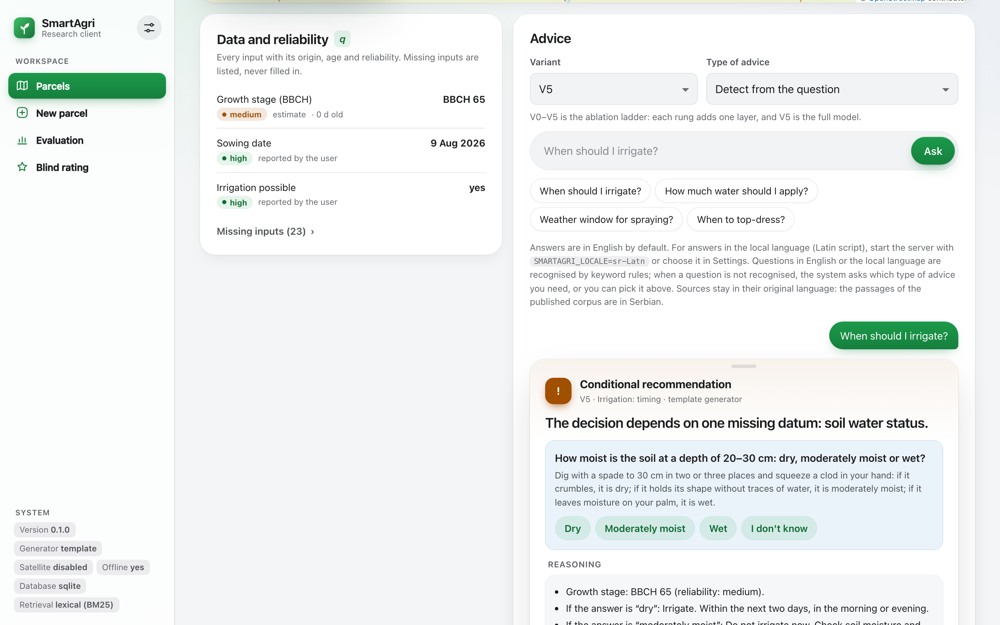

# SmartAgri core

[](https://github.com/ZeljkoDzafic/smartagri-core/actions/workflows/ci.yml)

SmartAgri is an open, testable core for **active, uncertainty-aware agronomic advice**. It answers a farmer's
question about one parcel (maize) and decides, before any text is generated, whether it may advise at all: recommend,
give a conditional answer, ask a follow-up question, or abstain (with a referral to the extension service when the
question is out of scope or the corpus does not cover it).

The decision is made by explicit, deterministic layers; a language model (optional) only phrases the answer.

- **C** the decision context: parcel, agronomic inputs, Open-Meteo weather and Sentinel-2 L2A NDVI;
- **π** applicability of each knowledge passage (deterministic filter over passage metadata: crop, stage, region,
  date, source type);
- **q** quality of each input (origin, age, coverage, reliability);
- **σ** sufficiency of the inputs for the requested type of advice;
- **α** choice of the next question;
- **δ** the decision policy: one of four acts, recommend, conditional, ask or abstain; an abstention for an
  out-of-scope question or an insufficient corpus carries a referral to the extension service (a referral is not a
  separate act);
- **γ** grounding checks of a generated answer (numbers come from tools, sentences must be supported by passages).

Agronomic numbers are computed in code, never by the language model: ETc = Kc × ET0 with FAO-56 crop coefficients, a
simplified root-zone balance and gross depth = net / efficiency. The configuration values and the corpus are
development defaults pending agronomic review, and irrigation quantities are not shown in answers in this version;
see [Limitations](docs/limitations.md). [docs/layers.md](docs/layers.md) maps every layer to its code, configuration
and tests.

## Contents

| Path | What |
|---|---|
| `backend/src/smartagri/core/` | decision model π, q, σ, α, δ, FAO-56 tools, grounding |
| `backend/src/smartagri/retrieval/` | corpus loading, BM25 retrieval (fused with a dense ranking when `EMBEDDINGS_PROVIDER=fastembed`), corpus ingest and coverage |
| `backend/src/smartagri/pipeline/`, `providers/`, `llm/` | answer generation and judge, weather and satellite adapters, LLM providers |
| `backend/src/smartagri/evalkit/` | `python -m smartagri.evalkit run / report / export / guard / sweep / lock` |
| `backend/src/smartagri/research_api/` | minimal HTTP API and the web app (map drawing, profile, weather and NDVI, water balance, advice, provenance, evaluation overview, blind rating) |
| `backend/config/` | rules, thresholds, variants, question bank, Kc table (locked with the evaluation protocol) |
| `backend/corpus/` | corpus manifest (licence per document) and passages |
| `backend/eval/scenarios/dev/` | development scenarios; held-out test scenarios are published only after the protocol lock |
| `docs/` | documentation (see [Documentation](#documentation)), rater guide |
| `examples/` | `advise_one_parcel.py`: one parcel, one question, offline |
| `website/`, `tools/check_presentation_site.py`, `wrangler.jsonc` | static presentation site, its check and its Cloudflare deployment |
| `Dockerfile`, `docs/deployment.md` | container image and guide for a public deployment of the web app with accounts |

## Install and test

Python 3.12 is recommended; Python 3.9 is supported. Docker is not required.

```bash
cd backend
python3.12 -m venv .venv && . .venv/bin/activate
python -m pip install --upgrade pip setuptools           # an old pip/setuptools cannot do the editable install
pip install -c requirements.lock -e ".[dev,api]"         # Python 3.9: -c constraints-py39.txt
pytest -q                                                # SQLite, offline; no keys needed
```

`.env.example` (repository root) lists the optional settings: LLM provider, Copernicus credentials, offline mode,
retrieval mode, storage, accounts and the answer language of the web app (`SMARTAGRI_LOCALE`). None is required:
without them the system uses the deterministic template generator and BM25 retrieval, and works without keys. The
code does not read a `.env` file by itself; export the settings into the environment, for example after
`cp .env.example .env` and editing it, run `set -a; . ./.env; set +a` in the repository root before `cd backend`.

## Example

```bash
cd backend && . .venv/bin/activate
LLM_PROVIDER=template EMBEDDINGS_PROVIDER=none SMARTAGRI_OFFLINE=1 python ../examples/advise_one_parcel.py
```

[`examples/advise_one_parcel.py`](examples/advise_one_parcel.py) creates a maize parcel, builds its profile from
fixture data placed in the provider cache (no network), asks one irrigation question through the same Python
service the web app uses, and prints the act, the reason, the inputs with their reliability, the sources with their
applicability and the provenance hashes. CI runs it on every push.

## Run

```bash
cd backend && . .venv/bin/activate
python -m smartagri.research_api            # http://127.0.0.1:8100 — local use, no accounts
```

Locally there are no accounts and no cookies: everyone who can reach the server sees every parcel, as a single-user
research tool should. For a public server, see [Accounts](#accounts) and [`docs/deployment.md`](docs/deployment.md).

## Web app



Open `http://127.0.0.1:8100`. Draw a parcel on the map (or paste or import a GeoJSON polygon), fetch its profile and
see each input with its origin, age and reliability (q), ask a question under any variant V0–V5, answer the
follow-up question, and open "Why?" to see the π, q, σ, α, δ and γ decisions and the provenance hashes ("Download
provenance (JSON)" saves the whole answer with its decisions, sources, inputs and hashes). The parcel page also shows
the stored weather and Sentinel-2 NDVI series with their source and age, and a daily root-zone balance (ET0, Kc, ETc = Kc × ET0, rainfall, root-zone deficit, capped at TAW when the
optional soil texture is given) computed in code with the core tools. It is an illustration and does not feed the
advice; a missing series stays empty. The
read-only Evaluation page shows what `python -m smartagri.evalkit report` computes from the stored runs (development
runs are labelled as such), the leakage guard counts and the protocol lock; it is not linked from the rating screen.

The web app and the research API answer in English by default (`SMARTAGRI_LOCALE`, default `en`;
`research_api/locale.py`). `SMARTAGRI_LOCALE=sr-Latn` switches the interface and the answers to Serbian (Latin
script); a browser can also choose it in Settings (sent as `X-SmartAgri-Lang`). Questions are recognised in English
and in Serbian. Sources are quoted in their original language: the passages of the published corpus are short
paraphrases in Serbian, so source titles and excerpts appear in Serbian. Outside a web request the core's own default
locale applies, which is Serbian, Latin script (`i18n.py`, `DEFAULT_LOCALE`): evaluation runs, scenarios, the rater
view and the report tables are in Serbian. Evaluation runs never go through the API, so the answer language of the
web app does not change any result. The VC chat (a free LLM
conversation with the same data and sources) answers in the language of the message and needs `LLM_PROVIDER`. The
blind rating screen shows only the blinded item and the rubric, in the wording of the rater guide.

The client has no build step and loads nothing from a CDN; Leaflet 1.9.4 is vendored with its licence
(`research_api/static/vendor/leaflet/`). OpenStreetMap tiles are its only external request:
`SMARTAGRI_TILE_URL` sets another tile server (`none` turns tiles off; drawing still works) and
`SMARTAGRI_TILE_ATTRIBUTION` its attribution. Light and dark themes follow the system or the settings sheet.

## Accounts

Accounts are optional and off by default. `SMARTAGRI_ACCOUNTS` selects the mode:

| Mode | Behaviour |
|---|---|
| `off` (default) | Local single-user use, unchanged: no accounts, no cookies, every parcel is visible to everyone who can reach the server. |
| `optional` | For a public server. Anyone can draw a parcel and ask for advice without an account, but to **save** a parcel they create an account or sign in. Until then the parcel and its conversations are temporary: they belong to the browser session (an anonymous, HttpOnly session cookie that ends when the browser closes; the server keeps only its hash) and are deleted after `SMARTAGRI_ANON_TTL_HOURS` (default 24) without activity. Signing up or signing in saves that session's parcels to the account. Each user sees only their own parcels, and each anonymous session only its own. |

With accounts on, the sidebar shows **Sign in** (or the signed-in email, with Sign out and Delete account). For an
anonymous visitor every parcel is marked **Not saved**, with a **Save parcel** action and the note "Temporary — this
parcel is kept only for this browser session. Create an account to save it."; leaving the page with unsaved parcels
asks for confirmation. Accounts use an email address and a
password (at least 10 characters, stored as a scrypt hash). Email confirmation and password reset are available only
when SMTP is configured; without SMTP an account works as soon as it is created.

Protection: rate limits on every sign-in, sign-up and reset endpoint, login throttling per email and per address,
generic error messages, HttpOnly + SameSite=Lax cookies (Secure on https, host-only), sessions that expire
(`SMARTAGRI_SESSION_DAYS`, default 30) and end on sign-out, and a CSRF check (double-submit token and Origin) on every
state-changing request. The blind rating screen and its endpoints do not depend on accounts at all, and evaluation
runs never go through the API.

Parcels stored while accounts were off have no owner; with accounts on they are not shown to anyone until the
operator gives them to an account: `python -m smartagri.research_api --assign-unowned you@example.org`.

| Variable | Meaning |
|---|---|
| `SMARTAGRI_ACCOUNTS` | `off` (default) or `optional` |
| `SMARTAGRI_PUBLIC_URL` | public address, e.g. `https://app.smartagri.rs.ba`; used for email links, the Origin check and Secure cookies |
| `SMARTAGRI_ANON_TTL_HOURS` | hours without activity after which anonymous (not saved) parcels are deleted (default 24); purged lazily on requests and by `python -m smartagri.research_api --purge-anonymous` |
| `SMARTAGRI_SESSION_DAYS` | session lifetime in days (default 30) |
| `SMARTAGRI_COOKIE_SECURE` | `1` forces Secure cookies (automatic on https) |
| `SMARTAGRI_AUTH_RATE_FACTOR` | multiplies the per-address rate limits (default 1), e.g. many users behind one NAT |
| `SMARTAGRI_SMTP_HOST`, `_PORT`, `_TLS`, `_USER`, `_PASSWORD`, `_FROM` | outgoing email; confirmation and reset are on only when host, sender and `SMARTAGRI_PUBLIC_URL` are set |

### Privacy

With accounts on, the server stores: the email address and a password hash of each account; hashes of session and
one-time link tokens (never the tokens); the hash of each anonymous session token that created a parcel, with the
time of its last activity; and the parcels themselves (name, boundary, agronomic inputs), their data profiles, conversations and answers. Three cookies
are set, all strictly necessary and first-party: `sa_session` (sign-in), `sa_browser` (anonymous ownership) and
`sa_csrf` (request check); `sa_browser` is a session cookie and ends when the browser closes. There is no analytics and no tracking. The browser loads map tiles from the configured tile
server (OpenStreetMap by default), which sees the visitor's address; the server sends parcel coordinates to
Open-Meteo and, when configured, to Copernicus Data Space, and questions with parcel data to a language model only
when `LLM_PROVIDER` is set. **Delete account** removes the account, its sessions and links, and its parcels with their
profiles, conversations and answers. Anonymous parcels, with their profiles, conversations and answers, are deleted
automatically after `SMARTAGRI_ANON_TTL_HOURS` (default 24) without activity; signing out starts a new, empty
anonymous session. Whoever runs a public server is responsible for its privacy
notice and its backups, which keep deleted data until they expire.

## Settings

Every agronomic parameter of the configuration files can be set through the web app, at three levels over the file
defaults: **global** (an administrator), **user** and **parcel**. The effective value is the parcel's, else the user's,
else the global one, else the file default. Each parameter shows its file default, its unit, the allowed and the
recommended range, the source with its status (verified, partly verified, disputed, no source, development value) and
a "changed" marker; tables (Kc by BBCH range, root depth by stage, water capacity by texture, quality bands) have a
table editor with validation. The administrator decides per parameter whether users may change it and within which
range, sees the audit log and can restore a previous version or the file default. Evaluation reads the files only:
web settings never reach `evalkit`, the protocol lock or the blind rating screen, and every web answer records the
settings it used. With accounts on, administrators are listed in `SMARTAGRI_ADMINS`; in local mode the local user is
the administrator. See [docs/settings.md](docs/settings.md).

## Website

A static presentation of the project lives in [`website/`](website/). It is deployed to Cloudflare as static assets
of a Worker (`wrangler.jsonc`, workflow `Deploy website to Cloudflare`), currently at
<https://smartagri-core.calm-silence-b9f5.workers.dev>, with the custom domain `smartagri.rs.ba` to follow. GitHub
Pages remains an alternative (workflow `Deploy website to GitHub Pages`, run by hand). See
[`website/README.md`](website/README.md).

## Evaluation

`evalkit` runs an ablation ladder of variants V0–V5 (each rung adds one layer; the layer of V4 is q, σ and α, the
layer of V5 is δ and γ) and the LLM baseline VC over scenario sets, and supports blind rating, bootstrap intervals,
rater agreement, a leakage guard and a protocol lock that binds the code and the environment. See [`docs/evaluation.md`](docs/evaluation.md), [`docs/protocol.md`](docs/protocol.md) and
[`docs/reproducibility.md`](docs/reproducibility.md).

```bash
python -m smartagri.evalkit run --set dev && python -m smartagri.evalkit report
```

The development scenarios are a regression check of the installation, not an experiment; see
[limitations](docs/limitations.md#evaluation).

## Corpus licences

`backend/corpus/manifest.yaml` gives the source, URL and terms of every document. The published passages are short
paraphrases with citations, or the author's own notes; the corpus is licensed per document, separately from the MIT
licence of the code (see [NOTICE](NOTICE)). The published corpus is a 22-passage development corpus, most of whose
passages are still marked for verification against their source. A document whose terms do not allow
redistribution is to be published as metadata only (title, URL, terms); the corpus hash recorded in every run lets
you check a locally rebuilt corpus.

## Data sources and standards

FAO Irrigation and Drainage Paper 56 (crop coefficients, ETc = Kc × ET0), BBCH growth stages, Open-Meteo (forecast,
historical-forecast and previous-runs APIs, including FAO ET0), Copernicus Data Space Ecosystem (Sentinel-2 L2A, Statistical API),
OpenStreetMap tiles. Each keeps its own licence and terms; see [NOTICE](NOTICE) for the attributions they require.

## Documentation

| Document | Content |
|---|---|
| [docs/architecture.md](docs/architecture.md) | flow of one question, storage, packages |
| [docs/settings.md](docs/settings.md) | web settings: levels, administrator role and limits, history, evaluation isolation, API, how to add a parameter |
| [docs/parcel-features.md](docs/parcel-features.md) | the `parcel_features` data contract, causality rule, hashes, provider and how q uses it |
| [docs/layers.md](docs/layers.md) | every layer (C, π, q, σ, α, δ, γ) and agronomic tool mapped to code, configuration and tests; the four acts |
| [docs/limitations.md](docs/limitations.md) | what this version does not do, with the files to check |
| [docs/evaluation.md](docs/evaluation.md) | variants, comparisons and measures |
| [docs/protocol.md](docs/protocol.md) | evaluation protocol: outcomes, analysis plan, rater design, protocol lock |
| [docs/reproducibility.md](docs/reproducibility.md) | clean install, development run, report, protocol lock, results from a tagged release |
| [docs/RATER_GUIDE.md](docs/RATER_GUIDE.md) | instructions for blind raters (Serbian) |
| [docs/deployment.md](docs/deployment.md) | public deployment of the web app with accounts |
| [docs/adr/](docs/adr/README.md) | architecture decision records |
| [website/README.md](website/README.md) | the presentation website and its deployment |
| [CHANGELOG.md](CHANGELOG.md) | changes per version |

## How to cite

Use the metadata in [`CITATION.cff`](CITATION.cff) (GitHub shows it as "Cite this repository"). Cite the version you
used; each release is a git tag `vX.Y.Z`. A DOI will be added once releases are archived on Zenodo
(`.zenodo.json`).

> Džafić, Ž. (2026). *SmartAgri core: active, uncertainty-aware agronomic advisory* (Version 0.2.0) [Computer
> software]. https://github.com/ZeljkoDzafic/smartagri-core

When you publish results that use weather or satellite data obtained through this software, also give the
attributions listed in [NOTICE](NOTICE) (Open-Meteo, Copernicus Sentinel data).

## Contributing

Issues and pull requests are welcome; see [CONTRIBUTING.md](CONTRIBUTING.md) for the development setup, the checks
and the rules for locked files, and [CODE_OF_CONDUCT.md](CODE_OF_CONDUCT.md). Authors are listed in
[AUTHORS.md](AUTHORS.md).

## Security

Report vulnerabilities privately as described in [SECURITY.md](SECURITY.md), not in public issues.

## Licence

MIT for the code (`LICENSE`); the corpus and third-party components keep their own terms ([NOTICE](NOTICE)). A
commercial product built on this core is developed separately; it is not needed to run, check or reproduce anything
here.
